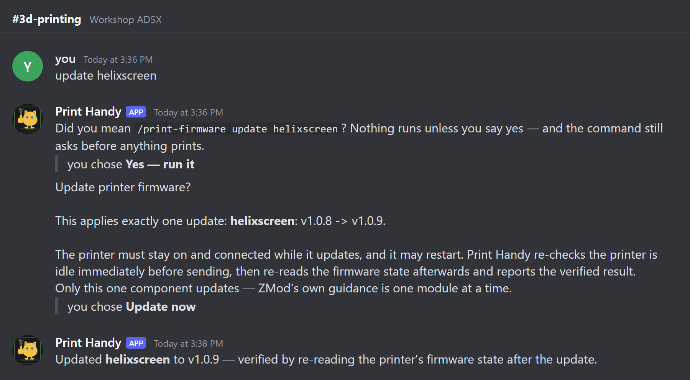

<p align="center">
  
</p>

# Print Handy

[](https://github.com/catduckgnaf/print-handy/actions/workflows/ci.yml)
[](https://discord.gg/mT2Ht3nqZu)

**Bambu Handy for every printer. Including Bambu printers. We're not petty.**

Ask for what you need in ordinary words: “How much purple PLA do I have?”, “What’s loaded?”, “Are there ZMod updates?” or “How much will this print cost?” Print Handy answers from your printer, Spoolman, and saved print records. Supported phrases and fuzzy matching are built into the Python command layer. No LLM parses those requests; performance helpers such as the G-code scanner can use Rust. When it’s time to make something, drop a model link or STL/3MF into Discord, Telegram, Matrix or the Web UI. It guides colors, copies, bed fit and slicing, then keeps you posted while the printer works. No slicer window to open for the everyday flow, and no Print Handy cloud.

The goal is a high Wife Approval Factor (WAF): when someone asks for a drawer divider, turn the request into a print, not a lesson in slicer settings. Check filament and cost in chat, approve the plate, and get on with dinner. If the print turns into spaghetti, Pasta Cam can flag it. If you like a little commentary, turn on the optional roasts. Printing should be fun.

Current release: **2.3.5** · [What’s coming in 2.3.6](docs/RELEASE-2.3.6.md)

[Install](#get-started) · [See it work](#from-link-to-print) · [Printer support](#find-your-printer) · [Full docs](https://catduckgnaf.github.io/print-handy-docs/) · [Discord](https://discord.gg/mT2Ht3nqZu) · [Releases](https://github.com/catduckgnaf/print-handy/releases)

## The fun stuff (and the genuinely useful stuff)

- **Drop a link or a file.** MakerWorld, Printables, Thingiverse, MyMiniFactory, Creality Cloud, Thangs, Nexprint, direct STL/3MF links and file uploads feed the print workflow. Some sites or downloads have limits or need credentials; [model sources](docs/PROJECT-REFERENCE.md) explains the details.
- **Tell the slicer what you want.** Pick colors, filaments and copies. Rotate, resize, split across plates and adjust supports from chat; Print Handy checks bed fit before making you waste filament on a sculpture of disappointment. OrcaSlicer and OpenSCAD are built in, so there's nothing else to install. [Model editing](docs/EDITING.md) has the supported operations and their limits.
- **Spoolman without the spreadsheet cosplay.** Track your filament, match spools to printer slots and get prompted when a spool runs out. A bundled Spoolman instance is included in the container; you can also connect your own. [Spools and commands](docs/PROJECT-REFERENCE.md).
- **Pasta Cam (Camera watchdog).** Camera checks can flag spaghetti, detached parts and other suspicious print behavior, with alerts and controls. Coverage depends on printer family, camera setup and enabled monitoring. It's a watchdog, not a psychic. Tune it with `PRINT_HANDY__VISUAL_WATCH__SENSITIVITY` (1 to 5). [Camera watch and compatibility](docs/DOCKER.md#camera-watch-visual_watch).
- **Print updates with attitude.** Progress, pauses, errors, finish posts, optional timelapses, model roasts and non-AI status quips. Some printer connections monitor only jobs Print Handy started. [Status voice](docs/STATUS-VOICE.md) · [Timelapses](docs/DOCKER.md#timelapse-capture-go2rtc).
- **Everyday slicing, in the conversation.** Drop a model link or file, answer the questions, and Print Handy handles the slicer. Ask for supported changes in plain language; fuzzy matching helps with typos and misspellings, while deterministic intent handling routes supported requests without treating a guess as permission. You do not need to open OrcaSlicer for the normal flow. [Model editing](docs/EDITING.md) · [Plain-language chat examples](#talk-to-it-in-plain-words).
- **A real Web UI.** Set up printers, work through a model link or upload, use chat in your browser, browse slices and print history, and view the **Pasta Wrapped** recap. Some recap/video features depend on the records and options available. [Web UI guide](docs/WEBUI.md).
- **Firmware, without pretending every printer is the same.** Check firmware versions and available components, including ZMod and HelixScreen updates; eligible ZMod and vanilla Klipper printers can apply a reported component update with confirmation. Other firmware paths get guidance or read-only reporting. [Exactly what updates work](docs/FIRMWARE-UPDATE.md).
- **Optional AI, with distinct jobs.** The everyday print flow, fuzzy typo handling, routine questions and local roast text don't require an LLM. AI design is optional and uses a configured design endpoint. Optional Web Chat AI and vision-endpoint features are separate, explicitly configured paths; vision can power camera analysis and other image features. [Design guide](docs/DESIGN.md) · [AI and chat behavior](docs/STANDALONE.md).

- **Home Assistant.** The [Print Handy integration](https://github.com/catduckgnaf/ha-print-handy) puts every printer in Home Assistant with live status and controls.

One container runs locally; the chat provider you choose still carries messages and attachments through its own service. The local Web UI doesn't need a Discord account. Don't mistake *local-first* for *every message stays in your basement*.

## From link to print

**1. Paste a model link. Choose the colors.** The printer doesn't care whether your taste is good.


**2. Pick the number of copies and review the slice choices.** One little dragon, eleven little dragons. We aren't judging. Much.


**3. Watch it start, or watch it get roasted.** Sometimes both.


<details>
<summary><b>More screenshots: fit checks, spools, Pasta Cam and the finish line</b></summary>

1. **Bed fit, geometry and the occasional uncomfortable measurement.** 
2. **Finished print and timelapse.** 
3. **Pasta Cam asks whether that's a print or an entrée.** 
4. **Pause, runout and spool choices.** 
5. **Changing a spool.** 
6. **A new Spoolman spool joins the party.** 
7. **Updating HelixScreen from chat.** One component, two yeses, and a re-read to prove it landed. 

These screenshots are **mockups based on real bot text and controls**, not proof of a hardware print. Their sources are documented in [assets/screenshots](assets/screenshots/README.md).

</details>

## Talk to it in plain words

Everyday questions and supported workflow requests do not need slash commands. In the print channel or Web UI chat, try:

- "How much purple PLA do I have?"
- "What's loaded?" / "What's in slot 2?"
- "Are there ZMod updates?" / "What firmware am I on?"
- "My first layer won't stick"

See [print cost questions](docs/COST.md) and [continuing a multipart project](docs/PROJECTS.md) for more phrases.

For ordinary questions, deterministic routing and local data answer what the system knows. Typo-tolerant fuzzy matching can help understand a misspelling; it does not mean every vague message is understood, nor does a match itself authorize a printer action. Intake still asks the normal questions and preserves its confirmation gates. Details and slash-command forms remain in the [command reference](docs/PROJECT-REFERENCE.md).

**Normal chat is local.** The optional AI paths are separate: **Web Chat AI is opt-in** and has its own Ask AI control; **designing is its own AI path** and needs a configured design endpoint. Vision features use their own configured endpoint and switches. Roasts come from local text and need no LLM. See [AI/chat behavior](docs/STANDALONE.md), [Design](docs/DESIGN.md) and [camera watch](docs/DOCKER.md#camera-watch-visual_watch).


## Get started

Three ways in: Docker (right here), [Unraid](#unraid) or the [Home Assistant add-on](#home-assistant-add-on).

**Docker** runs on 64-bit Linux (amd64 or arm64) with Docker and the Compose plugin. This is the short version; [the Docker guide](docs/DOCKER.md) covers version pinning, networks, storage, upgrades and every optional service.

```bash
mkdir print-handy && cd print-handy
curl -fLO https://raw.githubusercontent.com/catduckgnaf/print-handy/2.3.5/docker-compose.yml
curl -fL https://raw.githubusercontent.com/catduckgnaf/print-handy/2.3.5/.env.example -o .env
```

Edit `.env` and fill in three things:

- `PRINT_HANDY_IMAGE`: the image to run, as a pinned digest (`ghcr.io/catduckgnaf/print-handy@sha256:...`) from [Pinning the image](docs/DOCKER.md#pinning-the-image). There is no default, and that is deliberate: a tag can move or be republished, so a default would let the image change under you.
- Your chat: `DISCORD_BOT_TOKEN` and `PRINT_HANDY__DISCORD__CHAT_ID` from [Discord setup](docs/DISCORD-BOT-SETUP.md) (about 15 minutes). Prefer [Telegram](docs/TELEGRAM-BOT-SETUP.md) or [Matrix](docs/MATRIX-BOT-SETUP.md)? Set `PRINT_HANDY__BOT__PLATFORM` and that platform's token instead. The Web UI works either way.
- Your printer: `PRINT_HANDY__SERVICES__MOONRAKER_URL` for a Klipper printer. Other families don't magically have Moonraker; their variables are in [Printer support](docs/PRINTER-SUPPORT.md).

```bash
docker compose up -d
docker compose ps        # wait for "healthy"
```

1. **Claim the Web UI.** Open `http://<your-server>:8088` and **set its login during the first-run walkthrough**, or record that you mean to leave it open. Until then, anyone who can reach that port can use its printer controls.
2. **Say hello.** Send `/print-help` in your configured chat, or use the Web UI.
3. **Check the install.** `docker compose exec combined python3 -m print_handy.doctor` checks the settings, the slicer and every configured service, and names whatever is wrong.

### Unraid

In **Apps > Settings**, add `https://github.com/catduckgnaf/catduck-unraid-templates` under **Use DockerHub / Custom repositories**, then search Apps for **Print Handy**. The template and the Docker image are the same Print Handy, not two competing projects. See the [Unraid template repository](https://github.com/catduckgnaf/catduck-unraid-templates) and [Docker guide](docs/DOCKER.md) for networking and persistence.

### Home Assistant add-on

In **Settings > Apps > App store > Repositories**, add `https://github.com/catduckgnaf/print-handy-haos-addon`. Install **Print Handy**, start it and open the Web UI. Set its login, then connect your printer and optional chat platform. The add-on runs the published container through Home Assistant, with its own configuration and backup handling. [Full add-on guide](docs/HOME-ASSISTANT-OS.md).

Want printer entities in Home Assistant too? That's the separate [Print Handy integration](https://github.com/catduckgnaf/ha-print-handy), installed through HACS.

## Find your printer

Start with the printer you own: its **brand**, then the **model**, then the **firmware** it runs. The connection is listed last, as a detail, because nobody shops for a protocol. A built-in profile means Print Handy has the printer's definitions and offline tests; it **doesn't** mean someone printed on that exact hardware. [What does "supported" mean?](docs/PRINTER-SUPPORT.md) explains the levels, and the [model key list](docs/PRINTER-PROFILES.md#find-your-printer) names the exact setting for every printer below.

### FlashForge

One brand, five firmware routes. A printer can appear under more than one route; pick the firmware yours actually runs.

- **AD5X**: stock factory firmware (the printer's own LAN HTTP API) with the [stock FlashForge guide](docs/FLASHFORGE-STOCK.md), or [ZMod](docs/ZMOD.md) (Moonraker through ZMod).
- **AD5M, AD5M Pro**: [ZMod](docs/ZMOD.md) (Moonraker), or [Forge-X](docs/FORGEX.md) 1.4.2 beta (Moonraker on Forge-X's patched stock Klipper; not ZMod, never both).
- **Creator 5, Creator 5 Pro**: [ZMod](docs/ZMOD.md) (Moonraker), [OpenCreator](docs/OPENCREATOR.md) (Kalico and Moonraker), or [Reforge](docs/REFORGE.md) (Klipper and Moonraker, builds with AFC). Three firmwares, three separate sets of profiles.

A Creator 5 running OpenCreator is not running ZMod, a Creator 5 running Reforge is running neither, and a stock AD5X is not secretly a Moonraker printer. Same shell, different brains: pick the firmware yours actually runs, and Print Handy will say so if you guessed wrong.

**Hardware validation:** See the [live proof checklist #1082](https://github.com/catduckgnaf/print-handy/issues/1082) and the [ZMod AD5X hardware baseline](docs/DEVICE-AD5X.md#tested-baseline) for model-specific results.

### Creality

- **Ender-3 V3, Ender-3 V3 KE, Ender-3 V3 Plus, K1, K1C, K1 Max**: model-specific Klipper firmware, over Moonraker. [Creality guide](docs/CREALITY.md)
- **Ender-3, Ender-3 Pro, Ender-3 V2, Ender-3 V3 SE**: stock Marlin, through OctoPrint. [OctoPrint and Marlin guide](docs/OCTOPRINT-MARLIN.md)

### Qidi

- **Q1 Pro, X-Plus 3, X-Plus 4, X-Max 3, X-Smart 3**: model-specific Klipper firmware, over Moonraker. [Qidi guide](docs/QIDI.md)

### Snapmaker

- **U1**: Klipper-based firmware, over Moonraker. [Snapmaker guide](docs/SNAPMAKER.md)

### Bambu Lab

- **A1, A1 mini, A2L, P1P, P1S, P2S, X1, X1C, X1E, H2S, H2D, H2D Pro, H2C, X2D**: Bambu Lab firmware, over the Bambu Lab LAN connection. Slices happen locally; print starts are opt-in. [Bambu Lab guide](docs/BAMBU-LAB.md)

### Prusa

- **MK4S, CORE One, XL, MINI+**: Prusa firmware, over PrusaLink. [Prusa guide](docs/PRUSA.md)

### Elegoo

- **Neptune 4, Neptune 4 Pro, Neptune 4 Plus, Neptune 4 Max**: Klipper-based firmware, over Moonraker. [Elegoo guide](docs/ELEGOO.md)
- **Centauri Carbon**: Elegoo SDCP firmware, over SDCP on your network. [Elegoo guide](docs/ELEGOO.md)

### Anycubic

- **Kobra 2, Kobra 2 Neo, Kobra 2 Pro, Kobra 2 Plus, Kobra 2 Max**: community Klipper firmware, over Moonraker. [Anycubic guide](docs/ANYCUBIC.md)
- **Chiron, i3 Mega S, Kobra, Kobra Max, Kobra Neo, Kobra Plus, 4Max Pro 2, Vyper**: stock Marlin, through OctoPrint. [OctoPrint and Marlin guide](docs/OCTOPRINT-MARLIN.md)

### Sovol

- **SV01, SV01 Pro, SV02, SV03, SV04, SV05, SV06, SV06 Plus**: two routes each, Sovol's Klipper firmware over Moonraker, or stock Marlin through OctoPrint. [Sovol guide](docs/SOVOL.md)
- **SV06 ACE, SV06 Plus ACE, SV07, SV07 Plus, SV08, SV08 Max, Zero, M1D**: Klipper firmware, over Moonraker. [Sovol guide](docs/SOVOL.md)

### Any other Klipper or Marlin printer

- **Generic Klipper** (`klipper.generic`): any Klipper printer over Moonraker that is not listed above. You supply the bed size and macros; [printer support](docs/PRINTER-SUPPORT.md#your-printer-is-not-listed) explains.
- **Generic Marlin through OctoPrint** (`octoprint.marlin`): any Marlin printer behind an OctoPrint server. [OctoPrint and Marlin guide](docs/OCTOPRINT-MARLIN.md)

Don't see your printer at all? The [printer support guide](docs/PRINTER-SUPPORT.md#your-printer-is-not-listed) explains generic profiles and the [printer request form](https://github.com/catduckgnaf/print-handy/issues/new?template=printer_report.yml). No need to buy a new printer just to please the documentation.

## Docs, help and the people who made this possible

For the complete setup and command references, use the [documentation home](docs/README.md) or [documentation site](https://catduckgnaf.github.io/print-handy-docs/). For humans with problems, there's the [Discord server](https://discord.gg/mT2Ht3nqZu) and [GitHub issues](https://github.com/catduckgnaf/print-handy/issues). Code contributions go through [CONTRIBUTING.md](CONTRIBUTING.md).

### Thanks, seriously

The FlashForge community has done a remarkable amount of work convincing these printers to speak something other than corporate. Print Handy builds on those efforts; it isn't their firmware and doesn't claim to maintain it.

- **[ZMod](https://zmod.link)** for opening up the Adventurer and Creator printers through Klipper and Moonraker.
- **[OpenCreator](https://github.com/FlashForge-C5-Modding-Group/OpenCreator)** and the [FlashForge Creator 5 Modding Group](https://github.com/FlashForge-C5-Modding-Group) for their alternative Creator 5 firmware and documentation.
- **[Reforge / Klipper4FlashForge](https://github.com/Klipper4FlashForge/firmware)** for another independent Creator 5 custom firmware, and for documenting its print pipeline well enough that a [Print Handy profile](docs/REFORGE.md) could be built from it. Built from their docs, **not** yet tested on a real printer.
- **[OrcaSlicer](https://github.com/OrcaSlicer/OrcaSlicer)**, **[Spoolman](https://github.com/Donkie/Spoolman)**, **[Klipper](https://github.com/Klipper3d/klipper)**, **[Moonraker](https://github.com/Arksine/moonraker)**, **[OpenSCAD](https://github.com/openscad/openscad)** and **[go2rtc](https://github.com/AlexxIT/go2rtc)** for the tools that make slicing, spools, printer control, design and cameras possible.

Thanks also to everyone filing hardware reports, testing strange combinations, fixing bugs and contributing code. If your printer works because somebody spent a weekend deciphering a protocol, they deserve a credit and probably a nap. Third-party licenses and component details are in [Component provenance](docs/COMPONENTS.md).

*Not affiliated with Bambu Lab or the firmware projects above. We just think the good printer experience should be less exclusive.*

## License

Print Handy's **current code is licensed under [GNU Affero General Public License v3.0 only (AGPL-3.0-only)](LICENSE)**. See [NOTICE](NOTICE) and [third-party component licenses](docs/COMPONENTS.md) for applicable notices.
